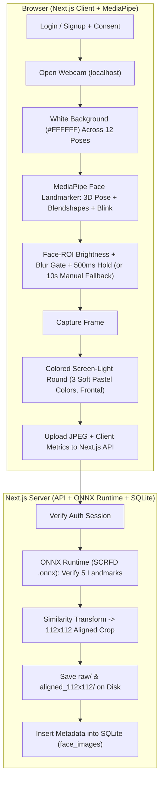

# Design Specification: Web-Based Face Dataset Registration System

**Date:** 2026-11-12
**Status:** Ready for User Approval

---

## 1. Intent & Why

Create a self-service web application that can be shared via link with friends so each person can log in from their own laptop or smartphone browser and capture a diverse, high-quality set of face images.

The resulting dataset will be used to train or fine-tune embedding-based face recognition models (**ArcFace**, **GhostFaceNets**, and **MobileFaceNet**). Once a model is trained, the system's **ONNX Runtime** layer and **SQLite** schema are designed to seamlessly support converting approved face images into embedding vectors (`face_embeddings`) for real-time cosine-similarity face recognition.

---

## 2. Goals, Non-Goals, and Anti-Goals

### Goals
- **Accurate Identity Labeling:** Require login before capture so every photo and folder maps deterministically to a specific `user_id`.
- **Model-Ready Diversity:** Guide users through **10 core + 2 conditional pose/expression steps** on an always-white background, followed by a **3-step colored screen-light reflection round** in frontal neutral pose.
- **Automated Quality Gating:** Reject blurry, underexposed, overexposed, eyes-closed, or multi-face frames before saving.
- **Standardized Output:** Store both preserved `raw/` frames and `112×112` 5-point aligned face crops (`aligned_112x112/`) organized by `user_id`, indexed by **SQLite** metadata.
- **Post-Training Readiness:** Provide a clean `onnxruntime-node` inference hook and `face_embeddings` SQLite table so trained `.onnx` models can later populate vectors and run recognition without redesigning storage.

### Non-Goals
- **In-app model training:** Model training (PyTorch / InsightFace) runs offline outside this web app using the exported dataset folders.
- **Full production attendance/access-control UI:** End-user recognition screens are out of scope for v1 (only the architecture/schema hook for embeddings is included).
- **Heavy cloud infrastructure:** No external SQL server, distributed object storage, or Kubernetes setup required for v1.

### Anti-Goals
- Do **not** store raw image binary blobs inside SQLite (keep images on disk and paths in SQLite).
- Do **not** allow unauthenticated uploads that could mix people into the wrong class folder.
- Do **not** push yaw angles beyond ~35° where one eye disappears and breaks 5-point alignment for MobileFaceNet/GhostFaceNets.
- Do **not** use dark monochromatic screen flashes that wipe out facial texture across RGB channels.
- Do **not** save rapid burst duplicates of identical frames.

---

## 3. Constraints

- **Localhost First (No Public Internet Yet):** v1 runs locally on the owner's Windows workstation (`http://localhost:3000`). Browsers treat `http://localhost` as a secure context for `navigator.mediaDevices.getUserMedia` without TLS setup. Keep all routes and asset paths relative so adding an HTTPS tunnel or VPS deployment later requires no code changes.
- **Cross-Device Browsers:** Frontend must use standard browser WebRTC (`getUserMedia`) and MediaPipe WASM/WebGL compatible with desktop Chrome/Edge/Firefox and mobile browsers (when later exposed over HTTPS).
- **Single-Node Storage:** SQLite + local filesystem storage targets small-to-medium cohorts (tens to low hundreds of users on one machine).
- **Offline Assets / Model Weights:** MediaPipe Face Landmarker WASM/task files (~4–6 MB) and server SCRFD `.onnx` weights must be served cleanly from local `public/` or `models/` directories so the app works offline and does not break if third-party CDNs fail.

---

## 4. Approaches Considered & Chosen

1. **Approach A — Browser MediaPipe + Python FastAPI Backend:**
   - *Pros:* Native Python OpenCV/InsightFace alignment (`cv2.warpAffine`) matching training pipelines.
   - *Cons:* Requires running and deploying two separate runtimes (Node/static frontend + Python backend).
2. **Approach B — Pure Next.js / TypeScript + Canvas Alignment (without ONNX Runtime):**
   - *Pros:* Single JS/TS stack.
   - *Cons:* Harder to match InsightFace/SCRFD 5-point detection & integrate future `.onnx` recognition models cleanly.
3. **Approach C — Thin Browser + WebSocket Streaming to Python Server:**
   - *Pros:* Thin client, identical server detector.
   - *Cons:* Noticeable lag on mobile/home networks while turning head; high server CPU/bandwidth under concurrent users.

### Chosen Approach: **Next.js Full-Stack + MediaPipe Face Landmarker (Client) + ONNX Runtime (Server) + SQLite**
- **Why:** Combines zero-lag 60fps real-time 3D head-pose, blendshape, and blink detection in the browser (`@mediapipe/tasks-vision`) with a single **Next.js** codebase, **SQLite** for zero-config structured metadata, and **`onnxruntime-node`** on the server for standardized SCRFD 5-point `112×112` alignment and future ArcFace / GhostFaceNets / MobileFaceNet `.onnx` embedding extraction.

---

## 5. System Architecture & Data Flow



---

## 6. Capture Protocol & Dataset Diversity Design

### Phase A: Pose & Expression Set (White `#FFFFFF` Background Always Active)
Throughout all 12 steps below, the full page background remains pure white (`#FFFFFF`) to act as soft, consistent fill light around the centered camera preview.

**10 Core Steps (Mandatory):**
1. `frontal_neutral`: Frontal (`|yaw| <= 6°`, `|pitch| <= 6°`, `|roll| <= 8°`), neutral expression, normal framing.
2. `frontal_smile`: Frontal, natural smile (`mouthSmileLeft` & `mouthSmileRight` blendshapes above threshold).
3. `frontal_mouth_brow`: Frontal, mouth open or eyebrows raised (`jawOpen` or `browInnerUp` blendshape above threshold).
4. `frontal_scale_shift`: Frontal neutral, slightly closer or slightly farther (face bounding-box width differs by >= 15% from step 1).
5. `yaw_left_15`: Head turned left `12°–20°`.
6. `yaw_left_30`: Head turned left `23°–33°`.
7. `yaw_right_15`: Head turned right `12°–20°`.
8. `yaw_right_30`: Head turned right `23°–33°`.
9. `pitch_up_15`: Head tilted up `10°–18°`.
10. `pitch_down_15`: Head tilted down `10°–18°`.

**2 Conditional / Optional Steps:**
11. `frontal_glasses_toggle`: Frontal neutral with glasses taken off/put on (shown only if user checks *"I wear glasses"* before starting; otherwise skipped).
12. `roll_tilt_15`: Head tilted sideways left or right (`10°–20°` roll) — *(My Call)* prompted for all users to simulate off-level cameras, with an explicit **"Skip"** button so users with neck discomfort or strict time limits can bypass it.

### Phase B: Colored Screen-Light Reflection Round (Frontal Neutral)
After Phase A, the full-screen background switches sequentially through **3 bright pastel colors** (maintaining high luminance so all RGB channels retain facial structure while casting real directional color reflections on skin and eyewear):
13. `light_cool_blue`: Soft Cool Cyan-Blue (`#B8E2FF`)
14. `light_warm_amber`: Soft Warm Amber (`#FFE0B2`)
15. `light_soft_rose`: Soft Rose-Pink (`#FFD1E6`)

*(My Call — adjustable via config):* Capture **1 verified frame per step** (13–15 distinct images per session) by default so users complete registration in ~45 seconds without fatigue, while allowing retaking any step or starting an additional session later.

---

## 7. Real-Time Quality Gates & Fallback Behavior (Client-Side)

Before auto-capture fires (after holding target pose steady for ~500ms):
1. **Single Face Check:** Exactly 1 face detected; face bounding-box width must be at least **160px** (with a non-blocking *"Move closer"* nudge when `< 224px`) so standard 480p laptop webcams still pass without getting stuck.
2. **Eyes-Open Check:** MediaPipe `eyeBlinkLeft < 0.4` and `eyeBlinkRight < 0.4`.
3. **Face-ROI Brightness & Exposure Check:** Measured strictly inside the detected face bounding box (never full frame, preventing false passes when backlit):
   - Mean luminance `Y` (`0.299R + 0.587G + 0.114B`) within `[65, 215]` (0–255 scale).
   - Clipped overexposed pixel ratio (`Y >= 250`) `< 15%`.
4. **Sharpness / Blur Check:** 3×3 Laplacian variance computed inside the grayscale Face ROI must exceed the minimum sharpness threshold.

**10-Second Fallback Escape Hatch *(My Call)*:**
- If a user remains on any step for **10 seconds** without triggering auto-capture (e.g., low-resolution webcam or dim room during colored screen-light steps), reveal a **"Manual Capture"** button (plus **"Skip"** on Phase A step 12 / Phase B if still failing) so nobody gets permanently stuck.
- Frames captured via the fallback button are recorded with `capture_mode = 'manual_fallback'` in SQLite so the admin can quickly review/filter them in `/admin`. A session reaches `status = 'completed'` once all required steps are either captured or explicitly skipped via fallback.

---

## 8. Authentication, Consent, Database (SQLite), & Storage Layout

### Authentication, Consent, & Self-Service Access *(My Call)*
- Self-service registration & login (`/login`, `/register`) using `username`, `display_name`, `password` (hashed with Node `crypto.scryptSync`), plus a shared **`INVITE_CODE`** environment variable so only invited participants can create accounts.
- **Explicit Consent Gate:** Before first camera launch, users must accept a privacy/consent notice confirming their face photos will be used to train face recognition models; timestamp saved in `users.consent_accepted_at`.
- **Self-Service Review & Deletion (`/my-photos`):** Logged-in users can view their own captured sessions/photos, delete individual photos, or delete their entire account (cascading deletion of disk files in `raw/` & `aligned_112x112/`, plus SQLite `face_images`, `capture_sessions`, `face_embeddings`, and `users` rows).
- Authenticated HTTP-only signed session cookie (`SESSION_SECRET` env var).
- Admin role (`role = 'admin'`, seeded via env/CLI) unlocks `/admin` dataset inspection, `manual_fallback` filtering, approval toggling, and ZIP/CSV export.

### SQLite Schema (`data/app.db`)
1. **`users`**
   - `id` (TEXT PK, UUID)
   - `username` (TEXT UNIQUE NOT NULL)
   - `display_name` (TEXT NOT NULL)
   - `password_hash` (TEXT NOT NULL)
   - `role` (TEXT NOT NULL DEFAULT `'user'`)
   - `consent_accepted_at` (DATETIME NULL)
   - `created_at` (DATETIME)
2. **`capture_sessions`**
   - `id` (TEXT PK, UUID)
   - `user_id` (TEXT FK -> `users.id`)
   - `device_info` (TEXT)
   - `status` (TEXT: `'in_progress' | 'completed'`)
   - `created_at` (DATETIME)
   - `completed_at` (DATETIME NULL)
3. **`face_images`**
   - `id` (TEXT PK, UUID)
   - `user_id` (TEXT FK -> `users.id`)
   - `session_id` (TEXT FK -> `capture_sessions.id`)
   - `pose_type` (TEXT NOT NULL)
   - `lighting_type` (TEXT NOT NULL: `'screen_white' | 'light_cool_blue' | 'light_warm_amber' | 'light_soft_rose'`)
   - `capture_mode` (TEXT NOT NULL DEFAULT `'auto'`: `'auto' | 'manual_fallback'`)
   - `brightness_score` (REAL)
   - `blur_score` (REAL)
   - `yaw` (REAL), `pitch` (REAL), `roll` (REAL)
   - `raw_image_path` (TEXT NOT NULL)
   - `aligned_image_path` (TEXT NOT NULL)
   - `is_approved` (INTEGER NOT NULL DEFAULT 1)
   - `captured_at` (DATETIME)
4. **`face_embeddings`** *(Populated post-training via ONNX Runtime)*
   - `id` (TEXT PK, UUID)
   - `user_id` (TEXT FK -> `users.id`)
   - `source_image_id` (TEXT FK -> `face_images.id`)
   - `model_version` (TEXT NOT NULL)
   - `embedding` (BLOB NOT NULL — Float32Array)
   - `created_at` (DATETIME)

### Filesystem Storage Layout
```text
dataset_storage/
├── raw/
│   └── <user_id>/
│       └── <session_short>_<pose_type>_<lighting_type>.jpg
└── aligned_112x112/
    └── <user_id>/
        └── <session_short>_<pose_type>_<lighting_type>.jpg
```
- **Server-Side Alignment (`onnxruntime-node` + `sharp`):**
  - Server runs SCRFD `.onnx` on each uploaded raw JPEG to extract the 5 canonical InsightFace landmarks (left eye, right eye, nose tip, left mouth, right mouth).
  - Applies ArcFace's standard `112×112` similarity transform (`Umeyama` 2D affine matrix) via `sharp` / pixel resampling to produce `aligned_112x112/<user_id>/...jpg`.
  - If server SCRFD fails to detect a face (e.g., extreme edge case), reject the upload (`422 Unprocessable Entity`) and prompt the client to retake that step.

---

## 9. What's Left to the Builder

- **UI/UX Details:** Camera permission prompts, Thai step instructions, visual face-oval guide, animated pose arrows, countdown ring during 500ms stability hold, and step-review/retake gallery.
- **Calibration & Thresholds:** Exact webcam capture resolution request (recommend `1280×720` ideal), exact Laplacian blur threshold (calibrated against typical mobile/laptop webcams), and exact blendshape threshold tuning.
- **Admin & Export Tools:** `/admin` page or script to review/unapprove images, export `aligned_112x112/` + `metadata.csv` as a ZIP archive, and a CLI/API hook to batch-generate `face_embeddings` once a trained `.onnx` model is placed in `models/`.
- **Test & Verification Strategy:** Unit tests for 5-point similarity alignment math, quality metric functions (Face-ROI brightness & Laplacian variance), SQLite CRUD/auth guards, and upload API validation.
